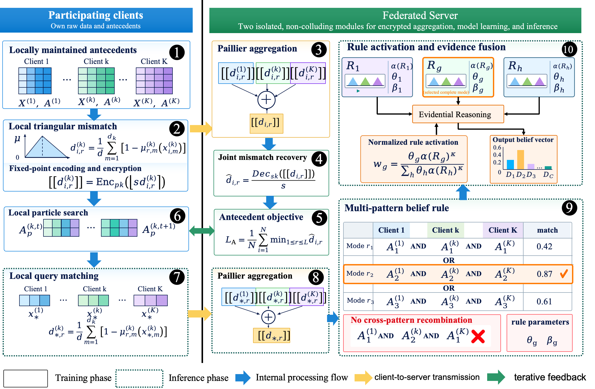

# JA-HE-BRB

This is the author-maintained reference code repository for **[Interpretable and privacy-preserving joint-antecedent belief rule learning in vertical federated learning with distributed labels](https://doi.org/10.1016/j.knosys.2026.117277)**, published in *Knowledge-Based Systems*.

**Ziqian Lin, Longhao Yang, Ying-Ming Wang**  
[Paper](https://doi.org/10.1016/j.knosys.2026.117277) · [Repository](https://github.com/coke2020ice/JA-HE-BRB)

<p align="center">

</p>

## Brief Introduction

JA-HE-BRB learns complete cross-client antecedents for distributed-label VFL and supports inspectable belief-rule reasoning. The publication describes protected aggregation; the included minimal executable is a plaintext, single-process reference example.

## Abstract

Vertical federated learning (VFL) enables institutions holding different attributes of aligned entities to train a joint model without sharing raw records. Existing VFL methods exchange model-dependent intermediate information and often assume a single label-holding party, offering limited support for transparent and traceable rule-based reasoning. Conventional belief rule bases (BRBs) generally require centrally available antecedent attributes and supervision. This paper proposes a joint-antecedent belief rule base protected by homomorphic encryption (JA-HE-BRB) for distributed-label VFL. It decomposes each complete joint antecedent into aligned client-local referential-value blocks and learns the locally retained antecedent referential values through label-independent distributed particle search with bounded triangular mismatches. Paillier encryption protects the aggregation of local mismatches and supervision contributions. Complete joint antecedents with compatible consequent belief distributions are synthesized into belief rules with alternative antecedents; the best-matching antecedent alternative represents each rule before the activated belief rules are aggregated using the evidential reasoning (ER) approach. On six public medical datasets, JA-HE-BRB shows competitive accuracy, macro-F1, balanced accuracy and G-Mean. It achieves the highest mean macro-F1 on five datasets, the highest balanced accuracy and G-Mean on SPECT, and the highest balanced accuracy on New-Thyroid. Robustness and communication-cost analyses assess stability and overhead, while encrypted tests confirm numerical consistency. In the New-Thyroid case, removing the strongest supporting rule reduces the normal-class belief from 0.798 by 0.126, demonstrating inspectable decision evidence.

## Dataset

The runnable example generates synthetic data locally; no download is needed. The paper evaluates six medical tasks, but their full reproduction pipelines are not included in this minimal release. Raw medical datasets and cached records are excluded.

## Requirements

```bash
python3 -m venv .venv
source .venv/bin/activate
python -m pip install -r requirements.txt
```

See `VALIDATION.json` for the observed local environment. Fresh installation of the pinned environment has not been independently validated.

## Main Baselines

This minimal release includes the proposed-model core and does not include a full baseline suite. Preserved manuscript comparison tables are in `paper_results/tables/`; their presence does not mean those baselines can be rerun from this package.

## Training and Evaluation

```bash
python train_JA_HE_BRB.py
```

Equivalent original entry point:

```bash
PYTHONPATH=src python examples/run_reference.py
```

Both run the same fixed-seed synthetic training/evaluation check; neither executes encrypted deployment or the full paper benchmark.

## Repository Structure

```text
train_JA_HE_BRB.py       # root reference entry point
src/dlhebrb/            # core implementation
examples/               # synthetic reference example
figures/Framework.png   # manuscript framework figure
paper_results/          # preserved submission figures, tables and disclosures
requirements.txt
CITATION.cff
```

## Scope and evidence

This release contains the particle joint-antecedent BRB core and a fixed-seed synthetic reference example, tested in the local environment recorded in VALIDATION.json. A clean installation of pinned dependencies has not been independently verified. This is not a verified full-paper reproduction package.

The example executes plaintext single-process aggregation, not an actual multi-party encrypted deployment. Paillier helper source is included, but end-to-end cryptographic execution is not validated by this example. Synthetic accuracy is not a paper benchmark.

paper_results/tables and paper_results/figures preserve eight tables and seven figures from the final 2026-10-14 submission package, not independently regenerated results. They have not been compared with the final publisher version. Read the protocol disclosure: CDC tuning is exploratory after outer-fold inspection, and run counts and budgets differ.

SOURCE_MANIFEST.json identifies original working-tree core source. PUBLIC_MANIFEST.json identifies this release. Raw datasets, caches, per-record predictions, logs, reviewer correspondence, and previous Git history are excluded. Historical code and experiments remain in private repositories.

## Citation

```bibtex
@article{lin2027jahebrb,
  title = {Interpretable and privacy-preserving joint-antecedent belief rule learning in vertical federated learning with distributed labels},
  author = {Lin, Ziqian and Yang, Longhao and Wang, Ying-Ming},
  journal = {Knowledge-Based Systems},
  year = {2027},
  pages = {117277},
  doi = {10.1016/j.knosys.2026.117277},
  url = {https://doi.org/10.1016/j.knosys.2026.117277}
}
```

## Contact

For code questions, please open a GitHub issue. For publication correspondence, use the contact information on the paper.

## License

No additional open-source license grant is assigned in this source release; author and third-party licensing review remains pending.
